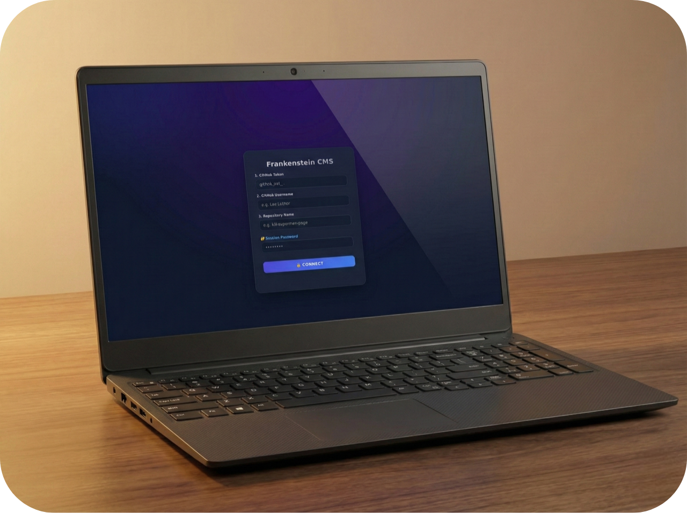
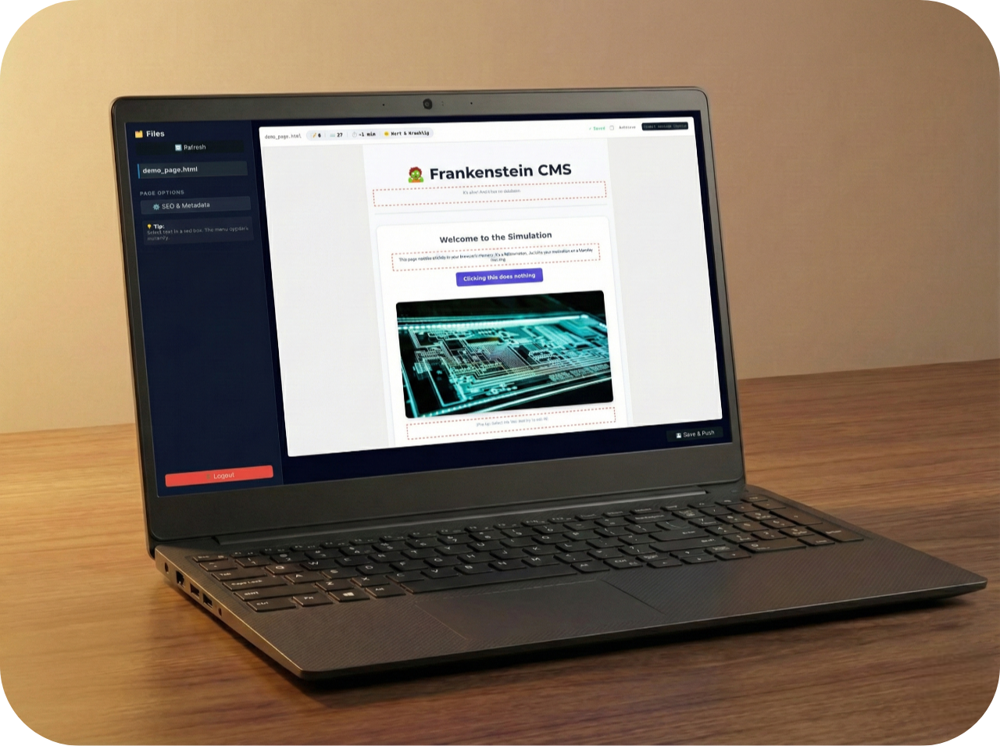

# Frankenstein CMS

**Because CloudCannon is too expensive and your static site deserves a soul.**

[](https://jpdeerenberg.github.io/Frankenstein-CMS/)
[](https://github.com/JPDeerenberg/Frankenstein-CMS/actions/workflows/ci.yml)

Frankenstein CMS is a **zero-install, single-folder content management system**
for static HTML sites on GitHub. No database, no build step, no subscription.
It edits your existing HTML through the GitHub API and works with GitHub Pages,
Netlify and any other static host.



## Deploy in 10 minutes

### One site, no server (`dev/`)

1. Copy the `dev/` folder into your site's repository (it can sit next to the
   site, as in this repo). Add `data-editable` to the elements the client may
   edit:

   ```html
   <h1 data-editable>Welcome</h1>
   <p data-editable>...</p>
   ```

2. Create a **fine-grained** GitHub token: _Only select repositories_ → your
   site → **Contents: Read and write**. Do not use a classic `repo`-scope token.
3. Open `dev/index.html` from GitHub Pages (or locally), enter the token, and
   start editing. Method B in the next section pre-fills the repo from
   `dev/frankenstein.config.json`; no server is involved.

### Clients, hidden token (`prod/` + Cloudflare Worker)

1. Create a Cloudflare Worker, paste
   `prod/worker/cloudflare-bouncer.mjs`, and create a KV namespace named
   `SITES`. The setup comments are at the top of that file.
2. Add one KV entry per client. Generate it locally:

   ```bash
   node scripts/new-site.mjs "Anna's Bakery" anna@example.com owner/repo --own-token
   ```

   Paste the printed **KV key** and **JSON value**. The password is 24 random
   letters/digits; `--own-token` adds a per-site token placeholder for repos
   that are not on the Worker owner's account. See `prod/worker/sites.example.json`.

3. Copy `prod/frankenstein.config.example.json` to
   `prod/frankenstein.config.json` and set `bouncerUrl` to your Worker.
4. Replace the permissive production `connect-src` with your bouncer origin:

   ```bash
   npm run prod:csp -- https://bouncer.example.com
   ```

5. Deploy the `prod/` folder. Every client uses the same URL and sees only the
   repo the Worker returns for their login.

The Worker also answers `?action=check` after login and reports whether the
site token can push. See [SECURITY.md](SECURITY.md) before going live.

## How it works

- **CSS.** Stylesheets and `<style>` blocks from the page are copied into a
  Shadow DOM preview. Repo stylesheets are fetched through the API; `body`/`html`
  selectors are rewritten only in the preview. External CDN stylesheets are
  fetched when CORS allows it, otherwise loaded as a normal `<link>`. Relative
  `url(...)` references in repo stylesheets become `blob:` URLs for the preview.
- **Private images.** `` sources are fetched with the user's credentials and
  shown as temporary `blob:` URLs. On save they are mapped back to the original
  repo path, so no `blob:`/`data:` URL is written.
- **Saves.** The file is rebuilt from the **original HTML**, not the live
  preview. Only the `innerHTML` of edited regions is replaced. The whole file is
  still serialised by the browser, so whitespace and attribute quoting can
  normalise; truly minimal, source-preserving saves are still open (PLAN.md).
  The current `sha` is sent with the write, so a concurrent GitHub change is
  detected (409) instead of overwritten.



## The two versions

### `dev/` — direct GitHub

For your own sites. The token is encrypted in the browser (AES-GCM, key in
IndexedDB). Configure it in one of three ways:

- **Manual login:** token, owner and repo in the form.
- **Local config:** copy your data into `dev/frankenstein.config.json`; fields
  pre-fill on reload.
- **URL / iframe:** `?owner=USER&repo=REPO`, or send a `postMessage` from a
  parent page. `dev/iframe.html` derives the CMS URL from its own location and
  never points at someone else's copy.

The `dev/` folder contains an example `frankenstein.config.json`; do not commit
a token into it.

### `prod/` — bouncer for clients

For agencies. Clients log in with email and password; the GitHub token stays in
the bouncer. Supported bouncers:

- **Cloudflare Worker** (recommended): one file, one KV namespace, no server.
- **Supabase** (`supabase-bouncer.sql` + `.ts`; deploy with `--no-verify-jwt`).
- **PHP** (`bouncer.php` + `sites.php`; keep the sites file out of the web root).
- **Node** (`node-bouncer.js`; useful as `backupBouncerUrl`).

The bouncer allowlists requests and write paths (HTML pages plus `img/` raster
images, never scripts, SVG or `.github/`). Put your own bouncer origin in the
production CSP and add a WAF rate-limit rule; the built-in throttle is only a
speed bump. Commits gain an `Edited-by: <display name>` line; the name comes from
the site's `editor` or `name` field, never from the client's email address.

## Project structure

- `dev/` — direct-GitHub CMS, token encrypted in the browser.
- `prod/` — client login + bouncer transport; `prod/worker/` holds all bouncers.
- `shared/js/` — source of truth for the 12 shared modules (`utils`, `doc`,
  `blocks`, `pwa`, `actions`, `boot`, `editor`, `ui`, `seo`, `igor`, `files`,
  `dialog`). `npm run sync` copies them into both folders with a generated
  header.
- `shared/sw.template.js` — service-worker template; sync fills the real asset
  list and a content-hash cache name from the files that exist.
- `shared/vendor/` — vendored water.css and other assets copied to both
  `vendor/` folders.
- `scripts/` — `sync.mjs`, `new-site.mjs`, `set-bouncer-origin.mjs`.
- `tests/` — `node --test` with jsdom and a fake GitHub API.
- `AGENTS.md` — short map and rules for contributors.

## Page settings, blocks and phones

**SEO.** Title, description, canonical URL, language, noindex, social title,
description and image, plus a live search preview. Igor reviews the fields and
the page (title/description length, missing share image, H1 count, images
without alt text, readability, long paragraphs, empty links) across every
editable region. Only fields you change are written.

**Blocks.** Insert-ready hero, text, image + text, columns, quote, call to
action, contact and divider sections. They are plain HTML with small inline
styles and `data-cms-block` markers, inserted next to a text block, and can be
moved or removed from the preview.

**Phone.** Slide-in file drawer, 44 px touch targets, a docked formatting bar and
an installable PWA. Real-device testing is still on the list; see PLAN.md.

## Development

```bash
npm install            # jsdom and fake-indexeddb are dev-only
npm run sync           # shared/ -> dev/ and prod/
npm run check          # sync check + Prettier check + tests
npm run format         # Prettier
npm test               # node --test
```

The generated copies in `dev/js/` and `prod/js/` are committed so the deployed
folders work without a build step. **Edit `shared/js/` or `shared/sw.template.js`
and run `npm run sync`; never hand-edit a generated copy.** The service-worker
cache name is derived from the cached files, so it refreshes automatically. CI
runs `npm ci && npm run check` on Node 24 with PHP 8.3 for the bouncer tests.

## Security

The bouncer is not an open proxy: it forwards only the GitHub paths the CMS
needs, only for the client's repo, and only writes allowed HTML/image paths.
Dev keeps the token encrypted at rest; prod never sends it to the client. See
[SECURITY.md](SECURITY.md) for the threat model, deployment checklist and
remaining risks.

## Known limitations

- **Quill 1.3.7 is bundled** (no CDN). It has one disputed, unpatched advisory
  (CVE-2021-3163). The CMS sanitises before Quill sees content and tests payloads
  through the editor and save step; Quill 2 is the long-term fix.
- **Quill keeps basic formatting** (bold, italic, underline, links, headings,
  lists, images with alt/size). Blocks with other markup get a warning before
  editing because the editor would drop it. Untouched regions are never edited.
- **Mobile Preview only narrows the editor.** CSS `@media` queries still follow
  the real browser window; the preview remains a Shadow DOM.
- **Phone use is verified in an emulated browser, not on a real device.**
- **Not a native app.** The PWA covers mobile use; there is no APK/store wrapper.
- **Blocks use inline styles**; restyle them with your own CSS if needed.
- **Selection in Shadow DOM** works in Chromium; Firefox/Safari are unverified.
- **Autosave commits to the default branch** every 30 seconds while there are
  changes, which can trigger a deploy. Leave it off unless you want that.
- Files that are not valid UTF-8 are refused.

See [PLAN.md](PLAN.md) for the remaining roadmap.
